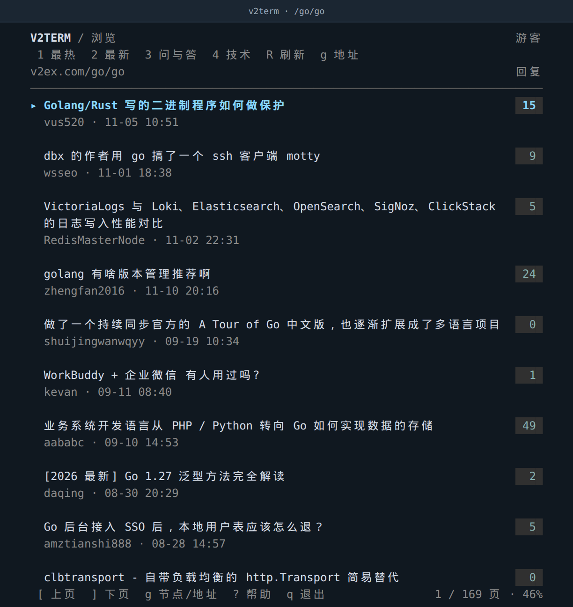
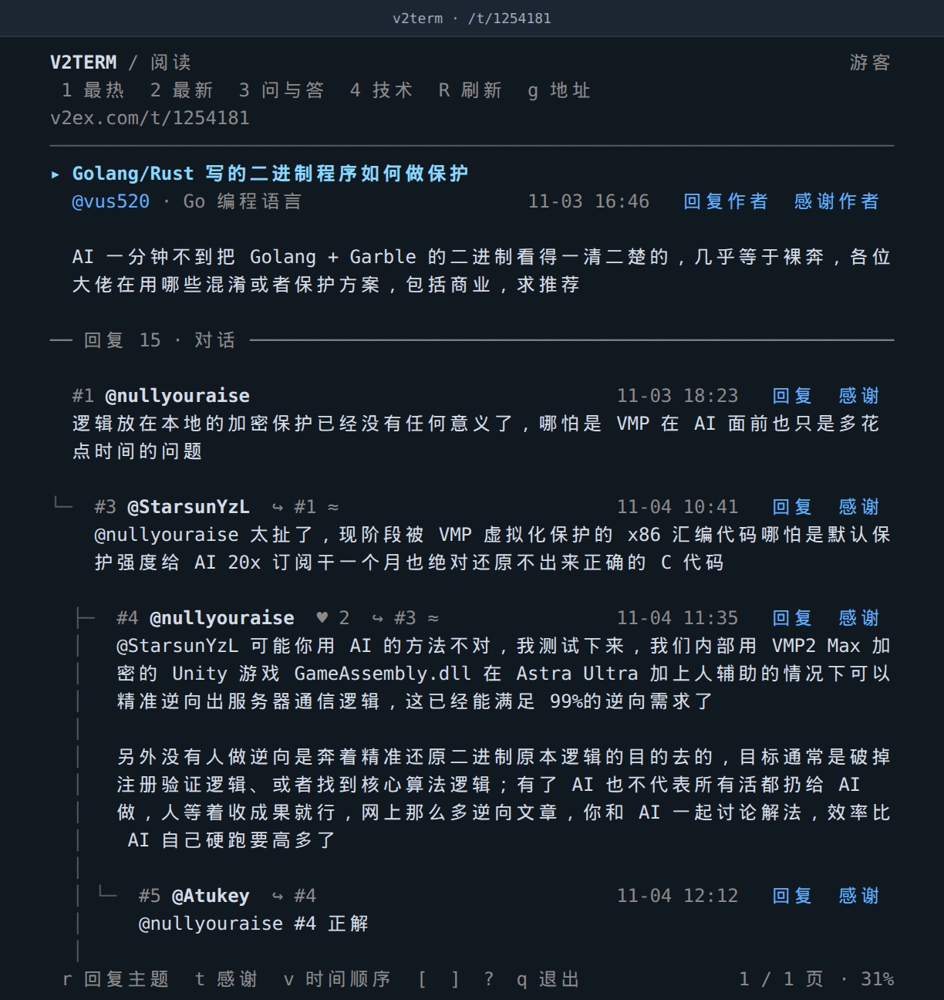

# v2term

V2EX 终端客户端。


[](LICENSE)

| V2EX 网页 | v2term |
| --- | --- |
|  |  |
|  |  |

来源：[Go 节点](https://www.v2ex.com/go/go)、[示例帖子](https://www.v2ex.com/t/1254181)。

## 特性

接近网页的浏览体验，支持鼠标操作、图片预览、热评和对话阅读，并保存阅读进度。

## 快速开始

从 [Releases](https://github.com/synrise25/v2term/releases/latest) 下载对应系统和架构的文件，解压后运行。提供 macOS、Linux、Windows 的 amd64（Intel／AMD 64 位）和 arm64 版本。

macOS 和 Linux 也可以通过 Homebrew 安装：

```sh
brew install synrise25/tap/v2term
v2term
```

Debian／Ubuntu 可添加签名软件源，支持 amd64 和 arm64：

```sh
sudo install -d -m 755 /etc/apt/keyrings
curl -fsSL https://synrise25.github.io/v2term/apt/v2term.asc | sudo tee /etc/apt/keyrings/v2term.asc >/dev/null
echo "deb [arch=$(dpkg --print-architecture) signed-by=/etc/apt/keyrings/v2term.asc] https://synrise25.github.io/v2term/apt stable main" | sudo tee /etc/apt/sources.list.d/v2term.list
sudo apt update
sudo apt install v2term
```

也可下载 `.deb` 后用 `sudo apt install ./文件名.deb` 安装。Windows 解压后运行 `v2term.exe`，建议使用 Windows Terminal；WinGet 已[提交社区审核](https://github.com/microsoft/winget-pkgs/pull/477313)，收录后可从默认源安装。

也可以在源码目录构建：

```sh
go build -o v2term ./cmd/v2term
./v2term
```

公开内容可以匿名浏览。首次打开「最热」，下次启动恢复上次退出的页面。顶部依次为「最热、最新、问与答、技术」，对应按键 `1`–`4`。

```sh
./v2term go             # 打开 Go 节点
./v2term 1254181        # 打开指定帖子
./v2term '/go/go?p=2'   # 打开指定分页
./v2term --fresh        # 忽略上次进度，从最热开始
```

| 操作 | 按键 |
| --- | --- |
| 选择帖子或楼层 | `↑` `↓` / `k` `j` |
| 打开帖子 | `Enter` / `→` / 鼠标点击 |
| 返回上一页 | `h` / `Backspace` / `Alt+←` |
| 滚动、翻屏 | 滚轮 / `PgUp` `PgDn` |
| 打开节点或地址 / 当前页查找 | `g` / `/` |
| 上一页 / 下一页 | `[` / `]` |
| 对话、时间顺序切换 | `v` |
| 回复 / 感谢所选内容 | `r` / `t` |
| 查看帮助 / 保存退出 | `?` / `q` |

## 登录

回复和感谢需要已登录 V2EX 的 Cookie，可通过文件或环境变量提供：

```sh
./v2term --cookie-file /path/to/v2ex-cookie
V2TERM_COOKIE='name=value; name2=value2' ./v2term
```

将浏览器请求中 Cookie 请求头的完整值保存为单行文件，或替换示例中的环境变量值。命令行指定的文件优先于环境变量。

## 配置

热评默认最多 3 条，最低感谢数为 3，无需每次指定启动参数。修改后可保存为配置：

```sh
./v2term config show                    # 查看配置及实际保存路径
./v2term config set hot_replies 5        # 最多显示 5 条热评
./v2term config set hot_min_thanks 3     # 至少 3 次感谢
./v2term config set scroll_lines 1      # 滚轮每次移动 1 行
```

`config set` 持久保存，命令行参数只对本次运行生效。Linux 下配置默认位于 `~/.config/v2term/config.json`；阅读进度单独保存在 `~/.local/state/v2term/state.json`，记录当前页面、滚动位置、导航历史和草稿，正常退出时更新。

登录、图片兼容性和完整配置见 [使用指南](docs/usage.md)，开发与测试见 [贡献指南](CONTRIBUTING.md)。

## 使用边界

v2term 是非官方客户端，通过网站页面读取内容和执行操作；网站改版或访问验证可能影响使用。遇到验证、会话过期或权限限制时，需要先在浏览器处理。

对话关联与热评只基于当前回复分页；自动推断的关联会标记 `≈`。感谢按网站规则扣除铜币，提交前需要确认。

## 许可证

采用 [MIT 许可证](LICENSE)。截图中的社区内容归原作者所有，V2EX 名称及标识归其权利人所有。
